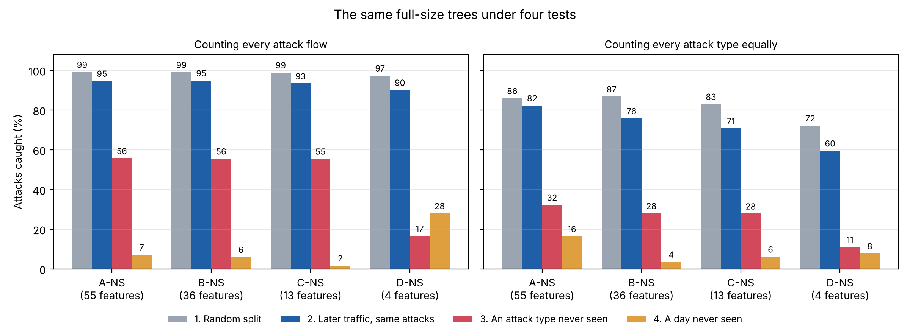

# Lightweight Cybersecurity Threat Detector

How small and cheap can a machine-learning model for detecting network attacks be made
before it starts missing attacks? This project trains decision trees on the public
**CICIDS2017** dataset, shrinks them step by step, and measures what each size costs and
what it loses, attack by attack.

**Research question:**
> How much detection performance can be retained while reducing the computational,
> memory, and model-size requirements of a machine-learning-based cybersecurity threat
> detector?

Author: Anush Jindal

---

## Two versions

The project has been done twice. The first version scored about 99.9%, which was too good
to be true, so the second version tests the trees on traffic they have not seen. Both are
kept here, each in its own folder.

| | [v1: random split](v1_random_split/) | [v2: unseen data](v2_unseen_data/) |
|---|---|---|
| Data | Wednesday only (610,492 flows, 5 attack types) | All five days (2,572,640 flows, 14 attack types) |
| What the tree learns | The name of each attack tool | Attack or normal |
| Features | Lists A-D (58 to 6 features), with and without 3 shortcut features | The shortcut-free lists only (55 to 4 features) |
| Test set | A random 20% of the same day | Later traffic, an attack type never seen, a day never seen |
| Attack flows caught | **99.9%** | **94.7%** later traffic, **55.7%** unseen attack type, **7.2%** unseen day |
| Smallest good tree | 3.7 KB (list C, depth 12) | 8.0 KB (list A-NS, pruned) |
| Status | Kept as it was, for comparison | Current |

## Why v1's 99.9% could not be trusted

1. **Random split of one day.** Each attack is one long burst of similar flows. Shuffling
   them puts near-copies of the training flows in the test set. With only the split changed
   to "train on the earlier part, test on the later part", DoS slowloris recall falls from
   99.1% to 59.1%.
2. **Shortcut features.** Destination port and TCP window size identify the lab's server,
   not the attack.
3. **Only attacks the tree had trained on.** The test set held the same five attack tools,
   from the same session. Kept out of training, an attack type is caught 32% of the time on
   average, and a port scan almost never.

## What v2 found



1. **The score depends almost entirely on the test.** The same kind of tree catches 99.2%
   of attack flows with a random split, 94.7% on later traffic, 55.7% of the flows of attack
   types it has never seen (32.3% counting each type equally) and 7.2% of the attacks on
   a day it has never seen.
2. **An unseen attack is caught only with help from the rest of its day.** With only that
   attack type held out, DoS Hulk is still caught 85.8% of the time and DDoS 63.0%. With
   their whole day held out, 14.1% and 0.0%.
3. **A bigger tree mainly buys recall on attacks it has already seen:** from 21% with one
   question to 82% at full size (averaged per attack type).
4. **Pruning shrinks the tree safely; depth limits do not.** Pruning removed 77% of the
   tree (35.5 KB to 8.0 KB) with the share of attack flows caught unchanged at 94.7%.
5. **False alarms rise on a new day,** from 0.08% to 1.2% on average.

None of these warnings is new on its own (see
[`research/literature_review.md`](research/literature_review.md), entries 8 to 13). What the
project adds is the size axis: the same size-versus-detection curve under four tests.

Full tables, per-attack results and limitations: [v2 README](v2_unseen_data/README.md).
v1's results (which attacks a smaller tree forgets first, the shortcut check, memory and
speed): [v1 README](v1_random_split/README.md).

---

## Repository layout

```
README.md              this file
research/              research question, literature review, references, attack types and
                       the table explaining all 78 features (shared by both versions)
data/                  where to download the CICIDS2017 files (the data is not committed)

v1_random_split/       FIRST VERSION, unchanged
  notebooks/           01-07: explore, clean, features, baseline, shrinking, figures,
                       Friday check
  experiments/         result files, figures and the dated log
  README.md            v1's full results

v2_unseen_data/        CURRENT VERSION
  notebooks/           01 why v1 scored so high, 02 prepare all days,
                       03 train and test, 04 results
  results/             one set of files per notebook (01_*, 02_*, 03_*, 04_*) and figures/
  helpers.py           code shared by the v2 notebooks
  notes.md             dated log
  README.md            v2's full results and a guide to every result file
```

The repository exactly as it was when v1 was finished is commit `e75145f`.

## How to run

```
pip install -r requirements.txt
```

Download the data as described in [`data/README.md`](data/README.md), then follow "How to
run" in the README of the version you want.

## Limitations

- All five days come from one lab network in one week. A new day in v2 is still the same
  network, so a different network is likely to be harder.
- CICIDS2017 has known labelling and flow-construction errors (Engelen et al., 2021;
  Lanvin et al., 2023), which these results inherit.
- Three attack types have fewer than 40 flows and cannot be scored reliably.
- Tree sizes are calculated and checked in software, not measured on a device.

Each version's README lists its own limitations in full.

## Next steps

- **Test on a different network:** CSE-CIC-IDS2018 has the same four DoS tools on another
  network (15 and 16 February 2018).
- **Compare with an anomaly detector** trained on normal traffic only, the usual approach
  to attacks nobody has seen.
- **Repeat tests 1 and 2 of v2 on several splits,** as v1 did.
- **Run the tree on a microcontroller:** export the pruned tree to C (for example with
  emlearn) and benchmark it on an ATmega328P and an STM32F401.
- **Use the corrected CICIDS2017** (Engelen et al., 2021) to check how much the dataset's
  labelling errors change the results.

## Dataset

Sharafaldin, I., Lashkari, A. H., & Ghorbani, A. A. (2018). Toward Generating a New
Intrusion Detection Dataset and Intrusion Traffic Characterization. *ICISSP 2018.*
Canadian Institute for Cybersecurity, University of New Brunswick:
https://www.unb.ca/cic/datasets/ids-2017.html
