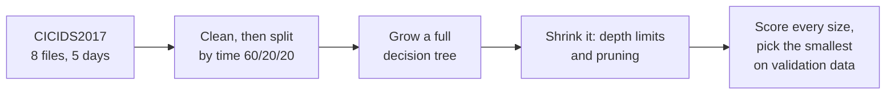

# What a Smaller Intrusion Detector Forgets

**Trading size for detection in decision-tree threat detectors**

[](https://www.python.org/)
[](https://scikit-learn.org/stable/)
[](https://www.unb.ca/cic/datasets/ids-2017.html)

Routers, IoT gateways and microcontrollers have kilobytes of memory, not gigabytes. This
project measures what a machine-learning intrusion detector loses when it is made small
enough to run on them. It trains decision trees on 2.57 million network flows from the
public CICIDS2017 dataset, shrinks them step by step, and records at every size what the
tree costs and which attacks it still catches.

> **Research question**
>
> How much detection performance can be retained while reducing the computational,
> memory, and model-size requirements of a machine-learning-based cybersecurity threat
> detector?

**Author:** Anush Jindal

---

## Contents

- [Key results](#key-results)
- [Method](#method)
- [Two versions of the study](#two-versions-of-the-study)
- [Repository structure](#repository-structure)
- [Getting started](#getting-started)
- [Limitations](#limitations)
- [Future work](#future-work)
- [Citation](#citation)

---

## Key results


*Recall per attack type against compact model size (log scale), for trees shrunk by depth
limits and by pruning. Scored on traffic recorded after the training data.*

The 55-feature tree, scored on traffic recorded after its training data:

| Tree | Nodes | Size | Comparisons per flow | Attack flows caught | Per attack type |
|---|---:|---:|---:|---:|---:|
| Full tree | 4,043 | 35.5 KB | 17.6 | 94.7% | 82.3% |
| **Pruned, chosen on validation data** | **913** | **8.0 KB** | **14.7** | **94.7%** | **80.2%** |
| Pruned further | 265 | 2.3 KB | 11.6 | 91.0% | 73.3% |
| Pruned to about 1 KB | 111 | 1.0 KB | 10.6 | 86.1% | 64.3% |
| A single question | 3 | 0.03 KB | 1.0 | 44.4% | 21.3% |

1. **Model size can be cut by about three quarters with no loss**, if the tree is pruned.
   The pruned tree (8.0 KB) fits in the 32 KB of program memory of an ATmega328P
   microcontroller; the full tree (35.5 KB) does not.
2. **Below that, the rarest attacks are forgotten first** while the overall score stays
   high. The 2.3 KB tree still catches 91.0% of attack flows but misses every Infiltration
   and SQL-injection flow. A depth-8 tree catches 84.6% of attack flows and none of the web
   attacks.
3. **Pruning beats depth limits.** No depth limit passed the validation check; pruning did
   for every feature list. Compared with the smallest depth-limited tree at least as large,
   a pruned tree caught as much or more per attack type in 77 of 96 comparisons.
4. **Computation falls much less than size**: 17% fewer comparisons for a tree 77% smaller.
   **Memory** depends on both the tree and the features. Fewer features save input memory
   (52 bytes for 13 features against 220 for 55) but do not make the tree smaller, and they
   cost detection on the less common attacks.
5. **What can be retained is detection of known attacks.** On attack types left out of
   training, trees of every size caught at most 33% per type, and on whole days left out at
   most 22%.

"Attack flows caught" counts every attack flow equally, so the three largest attacks (92% of
all attack flows) dominate it. "Per attack type" averages the recall of each of the 14
attack types, so a rare attack counts as much as a common one.

Full tables and per-attack results: [`v2_unseen_data/README.md`](v2_unseen_data/README.md).

---

## Method



| Step | What is done |
|---|---|
| **Data** | All eight CICIDS2017 files (3 to 7 July 2017). Rows with infinite values and exact duplicates removed: 2,572,640 flows, 2,146,899 normal and 425,741 attacks of 14 types. |
| **Labels** | The tree learns *attack* or *normal*. Attack names are kept only to score each attack separately. |
| **Features** | Four nested lists of 55, 36, 13 and 4 features. Destination port and the two initial TCP window sizes are excluded, because in this lab they identify the target server rather than the attack. |
| **Split** | Within each file and each label, the first 60% of flows (in recording order) for training, the next 20% for validation, the last 20% for testing. |
| **Model** | scikit-learn `DecisionTreeClassifier` with default settings. |
| **Shrinking** | Depth limits of 1 to 20 and no limit; cost-complexity pruning at twelve strengths from 1e-7 to 0.03. 2,016 tree sizes in total. |
| **Costs** | Nodes; compact size (9 bytes per node stored as plain arrays); average comparisons per flow; input memory (4 bytes per feature). |
| **Choosing a size** | The smallest tree for which every attack type with at least 100 validation flows keeps its recall within 1 point of the full tree, and false alarms rise by at most 0.1 points. |

Each tree is also tested three other ways, to check what it keeps on traffic it has not
seen:

| Test | Trains on | Tests on | Runs |
|---|---|---|---:|
| Later traffic (main test) | the first 60% of every attack and of normal traffic | the last 20% | 1 |
| Random split | a random 60% | a random 20% | 1 |
| New attack | everything except one attack type | that attack type | 14 |
| New day | four of the five days | the fifth day | 5 |

---

## Two versions of the study

The question was answered twice, and both versions are kept.

| | [v1: random split](v1_random_split/) | [v2: unseen data](v2_unseen_data/) (current) |
|---|---|---|
| Data | Wednesday only: 610,492 flows, 5 attack types | All five days: 2,572,640 flows, 14 attack types |
| What the tree learns | The name of each attack | Attack or normal |
| Features | Lists A-D (58 to 6), with and without the shortcut features | Shortcut-free lists only (55 to 4) |
| Test set | A random 20% of the same day | Later traffic, plus unseen attack types and days |
| Attack flows caught (full tree) | 99.9% | 94.7% |
| Smallest acceptable tree | 3.7 KB, but measured on near-copies | 8.0 KB |

v1 found that shrinking was almost free. That answer could not be trusted, for three
reasons:

1. **The split leaked.** Each attack is one long burst of similar flows, so a random split
   puts near-copies of training flows in the test set. With only the split changed to
   "train on the earlier part, test on the later part", recall on DoS slowloris fell from
   99.1% to 59.1% ([v2 notebook 01](v2_unseen_data/notebooks/01_why_v1_scored_so_high.ipynb)).
2. **Shortcut features.** Destination port and TCP window size identify the lab's server,
   not the attack.
3. **Only known attacks were tested.** The test set held the same five attack tools, from
   the same session.

v2 keeps the same research question and the same model, and fixes all three.

---

## Repository structure

```
threat-detection-model/
├── README.md
├── requirements.txt
├── data/
│   └── README.md                  where to download CICIDS2017 (data is not committed)
├── research/                      shared by both versions
│   ├── research_question.md
│   ├── literature_review.md       13 annotated sources
│   ├── references.md
│   ├── attack_categories.md
│   └── feature_documentation.md   all 78 features explained
├── v2_unseen_data/                current version
│   ├── README.md                  full results and a guide to every result file
│   ├── helpers.py                 cleaning, splitting, shrinking and scoring code
│   ├── feature_lists.json
│   ├── notes.md                   dated research log
│   ├── notebooks/
│   │   ├── 01_why_v1_scored_so_high.ipynb
│   │   ├── 02_prepare_all_days.ipynb
│   │   ├── 03_train_and_test.ipynb
│   │   └── 04_results.ipynb
│   └── results/                   8 CSV files and 5 figures, numbered by notebook
└── v1_random_split/               first version, kept unchanged
    ├── README.md
    ├── notebooks/                 01-07
    └── experiments/               results, figures and log
```

---

## Getting started

**Requirements:** Python 3.10 or later and about 4 GB of free memory. The published
results were produced with Python 3.13 and scikit-learn 1.9.1.

```bash
git clone https://github.com/anushjindal19/threat-detection-model.git
cd threat-detection-model
pip install -r requirements.txt
```

**Data:** download the eight CICIDS2017 CSV files (the `MachineLearningCVE` folder) and
place them in `data/`. Sources and file names are in [`data/README.md`](data/README.md).

**Run v2** from `v2_unseen_data/notebooks/`, in order:

| Notebook | What it does | Time on a 2-core CPU |
|---|---|---:|
| `01_why_v1_scored_so_high` | Random split vs split by time, on v1's data and model | 4 min |
| `02_prepare_all_days` | Cleans the eight files and marks train / validation / test | 1 min |
| `03_train_and_test` | Trains every tree and scores it at every size | 30 min |
| `04_results` | Tables, figures and findings from the saved scores | seconds |

To check that notebook 03 runs before the full run, start Jupyter with `QUICK=1` set. It
then uses every 25th flow and writes to `results_quick_test/`.

Instructions for v1 are in [`v1_random_split/README.md`](v1_random_split/README.md).

---

## Limitations

- All five days come from one laboratory network in one week. A detector moved to another
  network is likely to do worse.
- CICIDS2017 has documented labelling and flow-construction errors (Engelen et al., 2021;
  Lanvin et al., 2023), and this study uses the original files.
- The files have no timestamp column; recording order is taken from row order, which
  follows the published attack schedule but not exactly.
- Three attack types have fewer than 40 flows and cannot be scored reliably.
- Compact size is calculated in software, not measured on a device.
- No anomaly detector (a model trained on normal traffic only) was compared.

The full list is in [`v2_unseen_data/README.md`](v2_unseen_data/README.md#limitations).

---

## Future work

- **Run the pruned tree on hardware:** export it to C (for example with
  [emlearn](https://github.com/emlearn/emlearn)) and measure it on an ATmega328P and an
  STM32F401.
- **Test on a different network:** CSE-CIC-IDS2018 repeats the same DoS tools on another
  network.
- **Compare with an anomaly detector** trained on normal traffic only, the usual approach to
  attacks nobody has seen.
- **Repeat the main test on several splits** and on the corrected version of CICIDS2017.

---

## Citation

```bibtex
@misc{jindal2026smaller,
  author       = {Anush Jindal},
  title        = {What a Smaller Intrusion Detector Forgets: Trading Size for
                  Detection in Decision-Tree Threat Detectors},
  year         = {2026},
  howpublished = {\url{https://github.com/anushjindal19/threat-detection-model}}
}
```

## Dataset

I. Sharafaldin, A. H. Lashkari and A. A. Ghorbani, "Toward Generating a New Intrusion
Detection Dataset and Intrusion Traffic Characterization," *ICISSP 2018*. Canadian
Institute for Cybersecurity, University of New Brunswick:
https://www.unb.ca/cic/datasets/ids-2017.html
