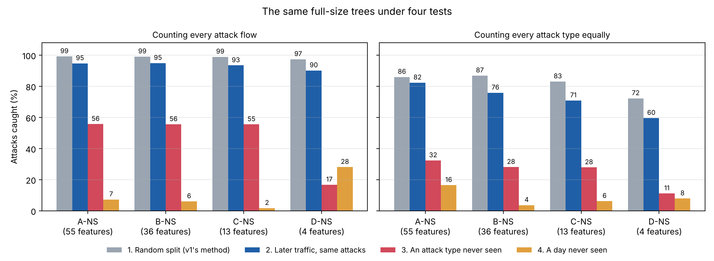

# v2: decision trees tested on traffic they have not seen

v1 scored about 99.9% and that number could not be trusted. v2 keeps the same model (a
decision tree) and the same research question, and changes how the tree is trained and,
above all, how it is tested.

## What changed from v1

| | v1 | v2 |
|---|---|---|
| Data | Wednesday only: 610,492 flows, 5 attack types | All five days: 2,572,640 flows, 14 attack types |
| What the tree learns | The name of each attack tool | **Attack or normal** |
| Features | Lists A-D, with and without three shortcut features | The shortcut-free lists only: **A-NS (55), B-NS (36), C-NS (13), D-NS (4)** |
| Test set | A random 20% of the same day | **Four tests**, three of them on traffic the tree has not seen |
| Choosing the tree size | Validation set cut at random | Validation set that comes later in time than the training set |
| Main score | Macro F1 over attack names | Recall for attacks the tree has seen and for attacks it has not, plus the false-alarm rate |

The shortcut features are `Destination Port`, `Init_Win_bytes_forward` and
`Init_Win_bytes_backward`. v1 showed that they describe the lab (which server was attacked),
not the attack.

## The four tests

| Test | Train on | Test on | Question |
|---|---|---|---|
| **1. Random split** | a random 60% of all flows | a random 20% | v1's method, kept only for comparison |
| **2. Later traffic** | the first 60% of every attack and of normal traffic, in time order | the last 20% | Does it still work later the same day? |
| **3. New attack** | the training part without one attack type | that attack type (all of its flows) and later normal traffic | Does it catch an attack tool it has never seen? 14 runs, one per attack type |
| **4. New day** | the training part of four days | the whole fifth day | Does it work on a day it has never seen? 5 runs, one per day |

The 20% between the training part and the test part is the validation set. It is used only
to choose the tree size.

## Notebooks

Run them in order. Each one saves its results to `results/` with the same number.

| Notebook | What it does | Time |
|---|---|---|
| `01_why_v1_scored_so_high` | Takes v1's data and model and changes only the split, from random to by time | 4 min |
| `02_prepare_all_days` | Cleans the eight files like v1 did, marks train / validation / test by time order, saves one table | 1 min |
| `03_train_and_test` | Trains the trees for all four tests and scores them at every depth limit and pruning strength | 30 min |
| `04_results` | Tables, figures and findings from the saved scores (no training) | seconds |

`helpers.py` holds the code all four notebooks share (cleaning, splitting, scoring).
`notes.md` is the dated log of what was done and why.

## Results

Full tables are in notebook 04. Words used:

- **Seen / unseen attack**: whether that attack type was in the training data.
- **All flows**: recall counting every attack flow equally. Three attacks (DoS Hulk, DDoS,
  PortScan) are 92% of all attack flows, so they decide this number. This is what v1 reported.
- **Per attack type**: recall worked out for each attack type, then averaged, so a rare
  attack counts as much as a common one.

### 1. The split is part of the reason v1 scored so high (notebook 01)

Wednesday only, v1's model, nothing changed except the split:

| List | Split | Attack recall | Macro F1 | DoS Hulk | DoS slowloris |
|---|---|---|---|---|---|
| A (58) | random (v1) | 99.91% | 0.997 | 99.9% | 99.1% |
| A (58) | by time | 99.07% | 0.841 | 96.1% | 59.1% |
| A-NS (55) | random (v1) | 99.38% | 0.991 | 99.4% | 99.0% |
| A-NS (55) | by time | 90.60% | 0.908 | 90.0% | 62.4% |

Exact copies are not the cause: for list A, 0.01% of test flows have an identical training
flow. The leak is near-copies from the same attack burst.

### 2. The same trees under four tests (notebooks 03 and 04)

Full-size trees. Tests 3 and 4 are averages over their runs.

| Test | List | Nodes | False alarms | Seen attacks: all flows | Seen attacks: per type | Unseen attacks: all flows | Unseen attacks: per type |
|---|---|---|---|---|---|---|---|
| 1. Random split | A-NS | 5,493 | 0.11% | 99.2% | 86.0% | – | – |
| | C-NS | 8,303 | 0.16% | 98.9% | 83.0% | – | – |
| 2. Later traffic | A-NS | 4,043 | 0.08% | 94.7% | 82.3% | – | – |
| | C-NS | 5,699 | 0.16% | 93.4% | 70.8% | – | – |
| 3. New attack | A-NS | 3,827 | 0.07% | 94.9% | 81.7% | 55.7% | 32.3% |
| | C-NS | 5,343 | 0.14% | 93.7% | 71.6% | 55.5% | 27.8% |
| 4. New day | A-NS | 3,219 | 1.18% | – | – | 7.2% | 16.4% |
| | C-NS | 4,294 | 0.21% | – | – | 1.7% | 6.2% |

All four lists: `results/04_summary_by_test.csv`.



### 3. Which attacks are caught when the tree has never seen them

List A-NS, full-size tree. "Seen" is test 2, "unseen" is test 3.

| Attack | Flows | Recall when seen | Recall when unseen |
|---|---|---|---|
| DoS Hulk | 172,846 | 89.8% | 85.8% |
| DDoS | 128,014 | 99.6% | 63.0% |
| PortScan | 90,694 | 99.8% | 0.2% |
| DoS GoldenEye | 10,286 | 99.8% | 3.4% |
| FTP-Patator | 5,931 | 97.2% | 0.0% |
| DoS slowloris | 5,385 | 76.9% | 70.9% |
| DoS Slowhttptest | 5,228 | 93.3% | 36.5% |
| SSH-Patator | 3,219 | 87.2% | 0.1% |
| Bot | 1,948 | 0.0% | 0.0% |
| Web Attack - Brute Force | 1,470 | 94.6% | 82.5% |
| Web Attack - XSS | 652 | 92.3% | 92.9% |
| Infiltration | 36 | 71.4% | 2.8% |
| Web Attack - Sql Injection | 21 | 50.0% | 14.3% |
| Heartbleed | 11 | 100.0% | 0.0% |

An unseen attack is caught only when a similar attack stayed in the training data (another
flood, another web attack, another slow DoS). Bot is missed even when seen: 0 of its 389
later flows are caught, although a random split reports 48.7%.

### 4. What shrinking the tree costs

List A-NS at every depth limit. Size and false alarms are from test 2.

| Depth limit | Nodes | Compact size (KB) | False alarms | Seen attacks, per type (test 2) | Unseen attack (test 3) | New day's attacks (test 4) |
|---|---|---|---|---|---|---|
| 1 | 3 | 0.03 | 0.04% | 21.3% | 22.8% | 18.1% |
| 3 | 15 | 0.13 | 2.53% | 39.1% | 16.0% | 8.1% |
| 6 | 89 | 0.78 | 0.50% | 50.0% | 18.3% | 1.7% |
| 10 | 279 | 2.45 | 0.10% | 69.3% | 18.8% | 3.1% |
| 12 | 409 | 3.60 | 0.05% | 69.8% | 30.7% | 4.7% |
| 20 | 1,825 | 16.04 | 0.08% | 79.8% | 32.7% | 16.4% |
| none | 4,043 | 35.53 | 0.08% | 82.3% | 32.3% | 16.4% |

A bigger tree mainly buys recall on attacks it has already seen.

**The smallest good tree, chosen on validation data** (test 2). Rule: every attack type with
at least 100 validation flows keeps its recall within 1 point of the full tree, and the
false-alarm rate rises by at most 0.1 points.

| List | Method | Nodes (full → chosen) | Compact size (KB) | Seen attacks: all flows | Seen attacks: per type | False alarms |
|---|---|---|---|---|---|---|
| A-NS | depth limit | 4,043 → 4,043 (no limit passed) | 35.5 → 35.5 | 94.7% → 94.7% | 82.3% → 82.3% | 0.08% → 0.08% |
| A-NS | pruning | 4,043 → 913 (−77%) | 35.5 → 8.0 | 94.7% → 94.7% | 82.3% → 80.2% | 0.08% → 0.07% |
| B-NS | pruning | 5,045 → 2,841 (−44%) | 44.3 → 25.0 | 94.9% → 94.9% | 75.8% → 75.8% | 0.09% → 0.10% |
| C-NS | pruning | 5,699 → 1,475 (−74%) | 50.1 → 13.0 | 93.4% → 93.3% | 70.8% → 71.0% | 0.16% → 0.13% |
| D-NS | pruning | 24,897 → 22,191 (−11%) | 218.8 → 195.0 | 90.1% → 90.2% | 59.6% → 59.6% | 0.24% → 0.25% |

No depth limit passed the rule for any list. All tests and lists: `results/04_chosen_trees.csv`.

### Findings

1. **The score depends almost entirely on the test.** List A-NS catches 99.2% of attack
   flows with a random split, 94.7% on later traffic, 55.7% of an attack type it has never
   seen and 7.2% of the attacks on a day it has never seen.
2. **Unseen attacks are caught only when a close relative was in training.** Otherwise
   recall is near zero (PortScan 0.2%, FTP-Patator 0.0%, SSH-Patator 0.1%).
3. **A seen attack can still be missed later the same day.** Bot: 48.7% with a random split,
   0 of 389 on later traffic.
4. **False alarms rise on a new day:** 0.08% on later traffic from seen days, 0.04% to 3.4%
   on an unseen day (1.2% on average).
5. **A bigger tree buys recall on seen attacks, and little else.** Seen attacks go from 21%
   (depth 1) to 82% (no limit) per attack type. Unseen attack types stay at 11-23% up to
   depth 10 and reach 31-33% from depth 12.
6. **Pruning shrinks the tree safely; depth limits do not.** Pruning removed 77% of the
   A-NS tree (35.5 KB to 8.0 KB) with the all-flows recall unchanged. A pruned tree matched
   or beat the depth-limited tree of at least the same size in 80% of comparisons on seen
   attacks and 76% on unseen ones.
7. **On a small device:** the full A-NS tree (35.5 KB) is too big for the 32 KB of an
   ATmega328P; the pruned one (8.0 KB) fits. Every tree fits the 512 KB of an STM32F401.

## Limitations

- Tests 1 and 2 are one split each. Tests 3 and 4 are averages over 14 and 5 runs.
- "Time" is the row order of the public CSV files, which have no timestamp column.
- Heartbleed (11 flows), Web Attack - Sql Injection (21) and Infiltration (36) are too small
  to score reliably.
- Depth-limited trees were made by cutting the full tree instead of re-training. Notebook 03
  measured at least 99.9% agreement with re-training at the depths it checked.
- In tests 3 and 4 the tree size is chosen on validation rows that hold only seen attacks.
- All five days are one lab network in one week, so a different network is likely to be
  harder. The feature lists were chosen on Wednesday's data in v1.
- CICIDS2017 has known labelling and flow-construction errors (Engelen et al., 2021;
  Lanvin et al., 2023).
- Timings and memory were not re-measured in v2. v1 found that they depend on the number of
  features, not on the size of the tree.

## Files in `results/`

| File | What it is | Rows |
|---|---|---|
| `01_random_vs_time_split.csv` | Wednesday, v1's model, random split vs split by time, for v1's 8 feature lists | 16 |
| `02_data_summary.csv` | Rows before and after cleaning, for each of the 8 files | 9 |
| `02_attack_counts.csv` | Flows of each attack type in the train / validation / test parts | 14 |
| `03_all_trees.csv` | **The main results.** One row per test × held-out attack or day × feature list × tree size | 2,016 |
| `03_recall_per_attack.csv` | The same trees, with recall for each attack type on the validation and the test rows | 48,384 |
| `04_summary_by_test.csv` | Full-size trees, averaged for each test and feature list | 16 |
| `04_recall_by_attack.csv` | Recall of each attack type when seen and when unseen | 14 |
| `04_chosen_trees.csv` | The smallest tree chosen on validation data next to the full tree, for each test, list and method | 32 |
| `figures/` | `fig1` random vs time split, `fig2` four tests, `fig3` seen vs unseen by attack, `fig4` recall at every depth, `fig5` depth limits vs pruning | 5 |

### Columns of `03_all_trees.csv`

| Column | Meaning |
|---|---|
| `test`, `held_out` | Which of the four tests, and the attack type or day kept out of training (`-` for tests 1 and 2) |
| `feature_list`, `features` | A-NS, B-NS, C-NS or D-NS, and how many features it has |
| `method`, `setting` | `depth limit` with the limit (`none` = full tree), or `pruning` with its strength (`ccp_alpha`) |
| `nodes`, `depth_reached` | Size of the tree and its longest chain of questions |
| `compact_kb` | Size stored as plain arrays, 9 bytes per node (13 above 65,535 nodes), as in v1 |
| `first_question` | The feature and threshold at the top of the tree |
| `avg_comparisons` | Average number of questions asked per test flow |
| `benign_rows`, `false_alarms`, `false_alarm_rate` | Normal test flows, how many were flagged, and the share |
| `seen_attack_rows`, `seen_attack_recall`, `seen_recall_per_attack_mean` | Test flows of attack types that were in training; recall over all of them; recall averaged per attack type |
| `unseen_attack_rows`, `unseen_attack_recall`, `unseen_recall_per_attack_mean` | The same for attack types kept out of training |
| `val_false_alarm_rate`, `val_attack_recall` | The same tree scored on the validation rows |

`03_recall_per_attack.csv` has the same first five columns, then `scored_on` (validation or
test), `attack`, `seen_in_training`, `rows`, `caught` and `recall`.

## How to run

```
pip install -r ../requirements.txt
```

1. Download the eight CICIDS2017 CSV files (see `../data/README.md`) into `../data/`.
2. Run the four notebooks in order from `v2_unseen_data/notebooks/`. Notebook 03 needs
   about 4 GB of free memory.
3. To check notebook 03 quickly before the full run, start Jupyter with `QUICK=1` set. It
   then uses every 25th flow and two feature lists, and writes to `results_quick_test/`.

All results in this folder came from one run on 12 November 2026 (scikit-learn 1.9.1,
2-core CPU).
